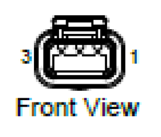
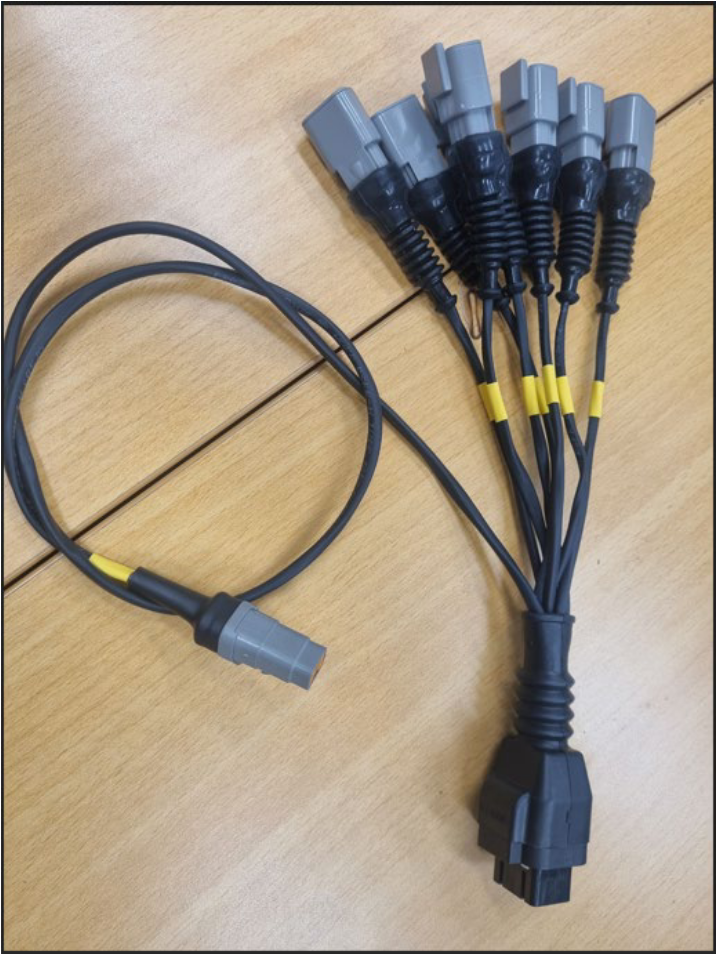
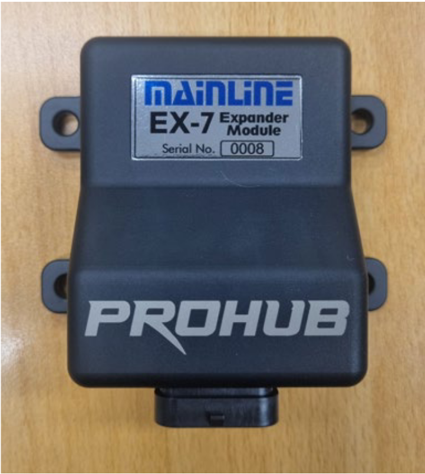

This cable is supplied with the Mainline CCS-EX7 CAN input Expander module.

The module allows 7 additional Inputs, 3 x 0-30V DC Inputs, and 4 x Digital Inputs. Each
supplied DTM3 connector has a Signal, a Signal Ground and a 5vDC supply. The Analog
inputs would typically be for adding additional pressure sensor etc, and the Digital
inputs could be used for Fuel Flow meters etc. To use a Digital Input on a typical Flex
Fuel Sensor that requires 12v DC supply, the user would have to make a revision to the
harness to use the 12v Expander Supply for the Flex Fuel Supply.

The pinouts for all 7 connectors are the same, Pin 1 is Ground, Pin 2 is the “Signal Input”
and Pin 3 is the 5v DC supply.

A generic CAN dataset for the EX7 will either already be supplied within the CCS
software, or can be supplied by Mainline, or can be downloaded from our Software
Download Server (available after February 2026). The generic data set will provide the
user with 3 “AN Volt” inputs, 4 x “Duty Cycle” Inputs and 4 x “Frequency” Inputs.

Users can then either make their own Maths Expressions to do what they choose with
these inputs, or additionally generate “Tables” to convert the Analog Inputs into specific
Pressure Channels. The CCS software does have some generic sensor tables under the
Functions – Tables tab for reference.

The supplied 4 pin DTM connector is to be plugged into CAN sockets 3A, 3B or 3C on the
CAN hub in the dyno Cabinet and then mounted in the cabinet in a similar fashion to the
supplied Lambda Module. Or, from March 2026, each new CCS system will have a
revised Boom Arm mounted Data Acquisition and Weather Station Module, and the EX7
can be mounted on the Boom Arm and plugged into the spare DTM4 port of the DA
module

