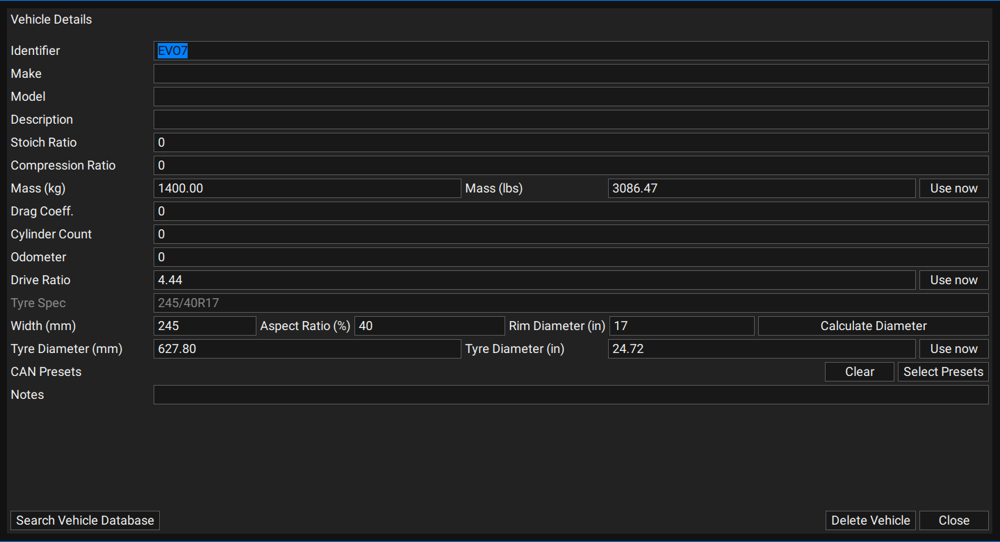
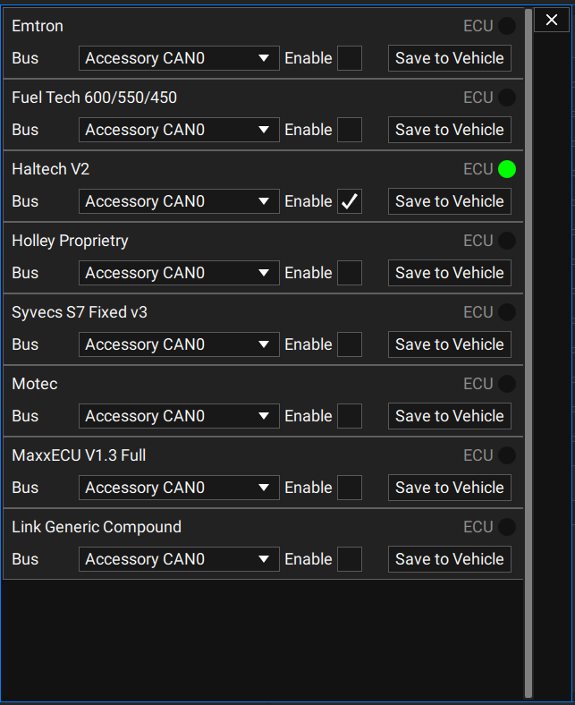
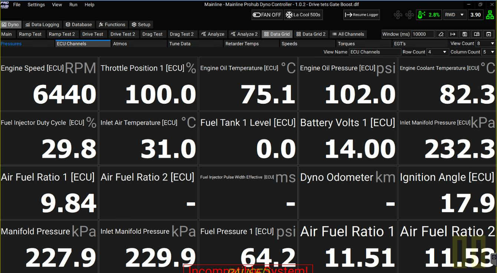
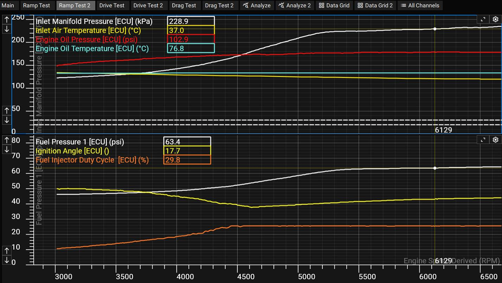
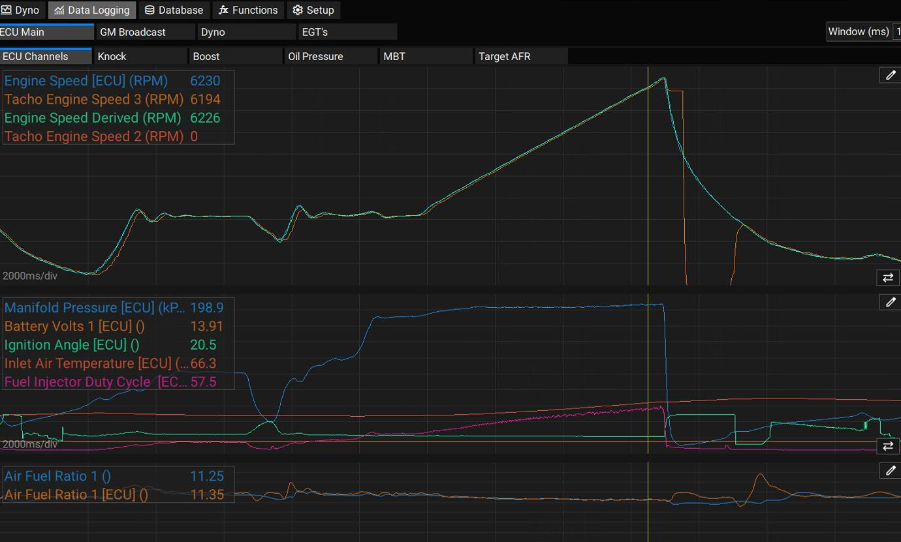
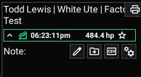
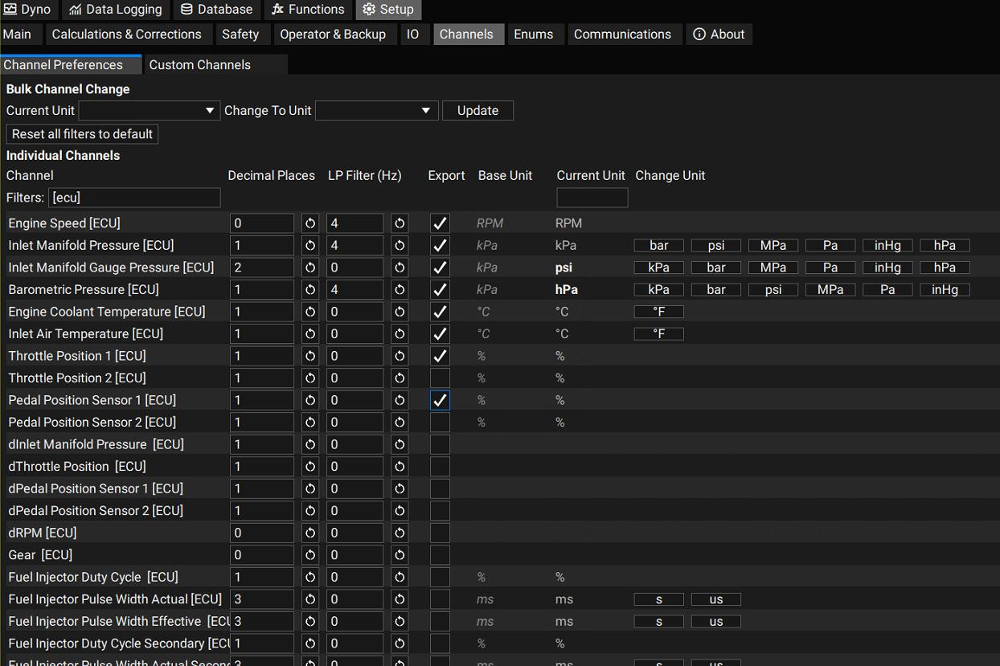
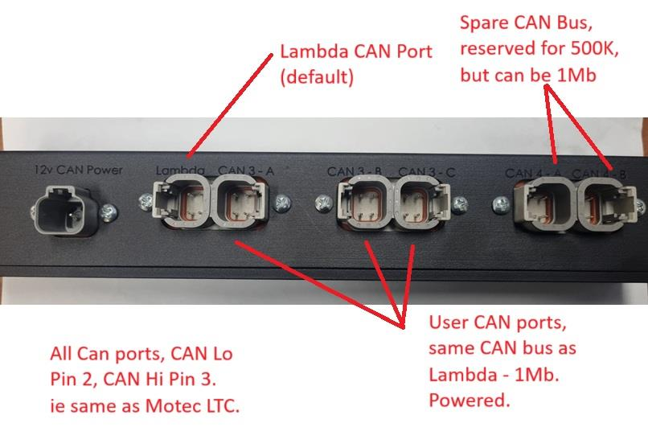

## Overview

The CCS software has a library of aftermarket ECU CAN datasets ("Presets") that can be assigned to a vehicle before dyno testing. Assigning a preset lets you:

- view live ECU CAN data
- have that data automatically recorded during any test
- log it for later review
- export any dyno channel — including ECU channels — to a CSV file at 100 Hz from a Ramp or Drive Test

Each CAN Preset also transmits common dyno channels back to the ECU where supported, such as Power, Torque, and Lambda values.

Defining a CAN Preset is quick and straightforward.

## Procedure

On the **Vehicle** tab (after adding a customer), click **Select Presets** at the bottom right:

The preset list window opens. Enable the ECU the vehicle has, then click **Save to Vehicle**. This tells the dyno program what CAN data stream to expect on a given bus — for example, that CAN0 will carry a Haltech V2 stream — so all channels in that standard stream become available in CCS.

## Where Preset Data Shows Up

**Data Grid** — ECU channels from the CAN stream can be shown on a fully user-definable Data Grid page, such as a dedicated "ECU Channels" page:

**Ramp Test** — chosen ECU channels can be plotted live during a test, for example on a "Ramp Test 2" page:

**Data Logging** — ECU channels can be added to a named Data Logging page (e.g. "ECU Channel"):

**CSV Export** — when a Ramp is paused, the dropdown on the Test ID includes a CSV export option, generating a file at 100 Hz containing every channel with the **Export** option ticked (set under **Setup → Channels**):

## CAN Wiring

Your CCS Dyno is supplied with a generic 2-pin DTM connector, 5 m cable, for ECU CAN connection. You'll need to make (or source) an adapter cable from the DTM 2-pin connector to the CAN bus in the vehicle — a DTM2-to-DTM4 adapter is supplied as standard for Haltech.

The other end of the generic ECU cable has a 4-pin DTM connector that typically connects to ports 3A, 3B, or 3C on the CAN Hub in the dyno cabinet. On the DTM 2-pin connector: Pin 1 is CAN Lo, Pin 2 is CAN Hi.

- All CAN ports: CAN Lo = Pin 2, CAN Hi = Pin 3 (same as Motec LTC).
- Lambda CAN port is the default port.
- The spare CAN bus is reserved for 500k but can run at 1 Mb.
- User CAN ports share the same bus as Lambda — 1 Mb, powered.
