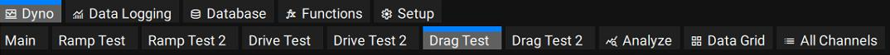
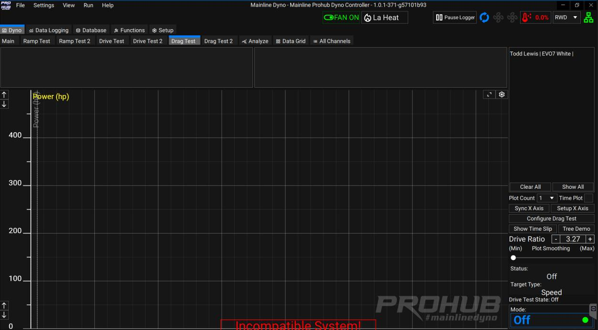
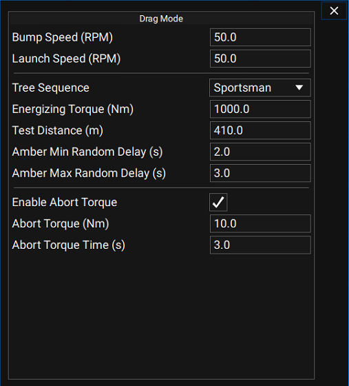
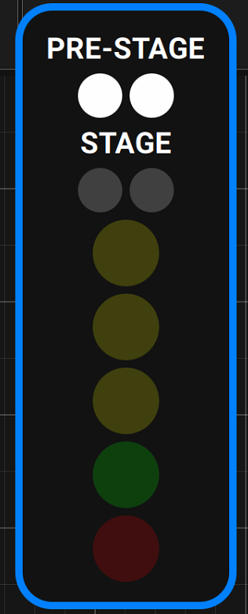
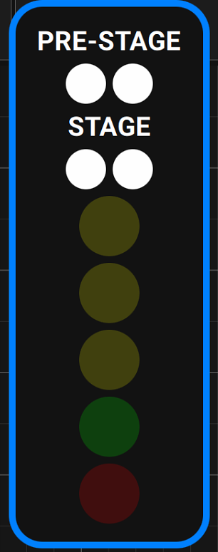
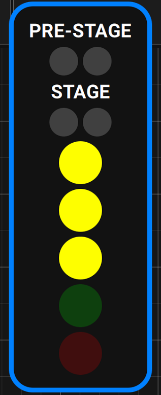
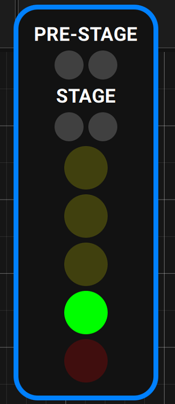
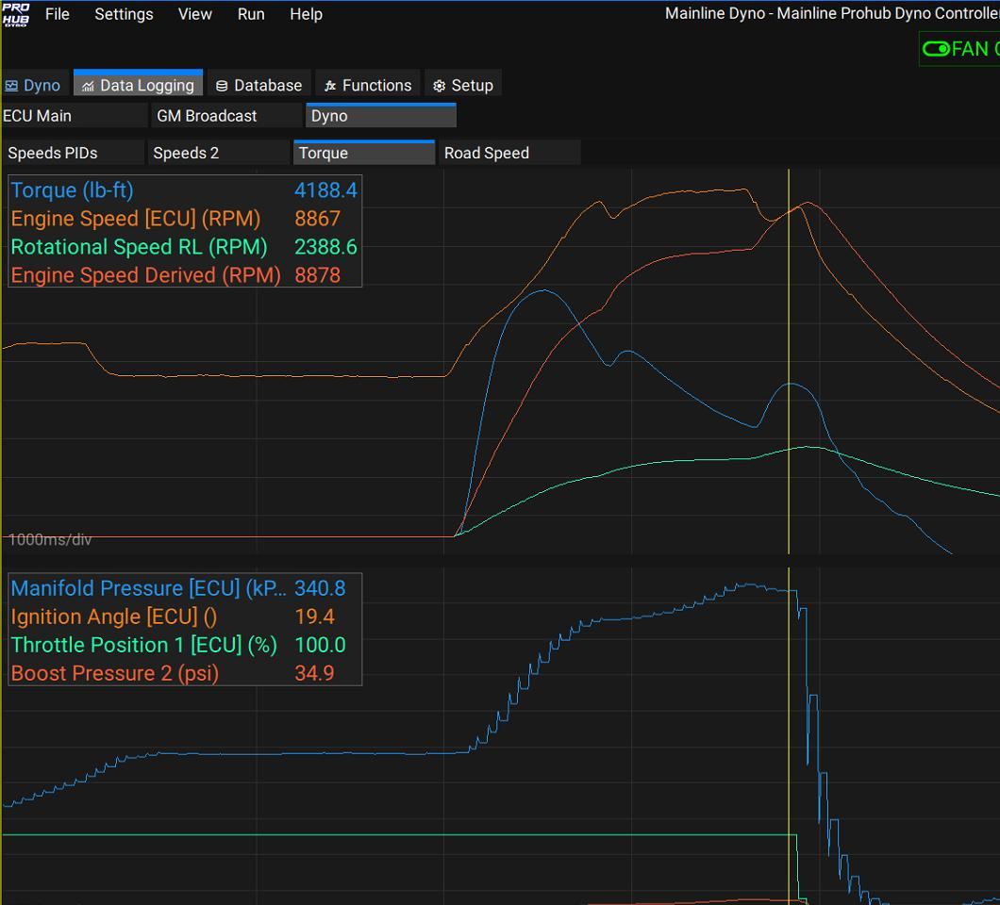

## Overview

The Drag Test function simulates a standing-start drag strip run, complete with a "Tree" start sequence (Pre-Stage, Stage, Amber, Green), a defined test distance, and an optional time slip.

To access it, click the **Drag Test** tab at the top of any screen in the software:

A blank Drag Test screen looks like this:

## Configure Drag Test

Click **Configure Drag Test** at the bottom right of the screen to open the settings window:

| Setting | Description |
|---|---|
| **Bump Speed (RPM)** | The Hub RPM that triggers the Test Tree to appear and brings on the first white light. |
| **Launch Speed (RPM)** | The Hub RPM that triggers the Start Sequence for the chosen Tree Sequence. |
| **Tree Sequence** | Sportsman, Pro, Hybrid, or Instant Green. |
| **Test Distance** | e.g. 410 m for ¼ mile, or 205 m for ⅛ mile. |
| **Amber Min Random Delay** | Minimum Amber delay time, in seconds. |
| **Amber Max Random Delay** | Maximum Amber delay time, in seconds. |
| **Enable Abort Torque** | Aborts the test if a minimum Torque value is detected for a set time. Abort Torque is the torque threshold; Abort Torque Time is how long it must be held before the test aborts. |

To configure a Drag Test, a **Bump Speed** and **Launch Speed** must be entered — the defaults are 50 RPM, measured as **Hub RPM, not Engine RPM**.

## Running the Test Tree

Once in Drag Mode, if the dyno sees 50 Hub RPM the first Tree light comes on:

You then need to completely stop the axle, the same as staging a car at the drag strip. "Creep" forward again to bring the axle back to 50 RPM, which triggers the Stage lights:

The Amber lights then count down according to the chosen Tree Sequence (a "Pro Tree" example is shown below):

Green means go — let go of the two-step, or just take off if it isn't a "drag style" launch:

## Time Slip and Test Distance

If the car reaches the end of the defined Test Distance, a time slip appears. If, for example, a 405 m Test Distance is defined but you only run an ⅛ mile, no time slip is shown.

The Drag Test is a **simulation only** — it will not produce a 100% accurate time slip. This is because no Eddy Current Retarder can deliver peak torque capacity from a dead stop. Typically the dyno reaches its highest torque capacity around 500 Hub RPM, so expect the initial part of the run through first gear to feel less loaded than expected: the dyno produces very little load from 0–150 Hub RPM, then torque capacity rises sharply up to its peak around 500 Hub RPM and is maintained for the rest of the test (with a slight drop-off as Hub RPM continues to climb).

## Display and Logging

The Drag Test window is fully user-definable. Any dyno channel can be shown, in 1–4 plot windows — for example Power only, or Engine RPM from any source such as Tacho Speed or ECU RPM.

It's recommended to save a Datalog after each Drag Test to review data from before and after the run:

In the example above, Engine RPM eventually lines up with the Drive Shaft / Derived Engine RPM once the converter locks up.
