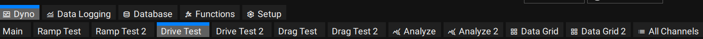
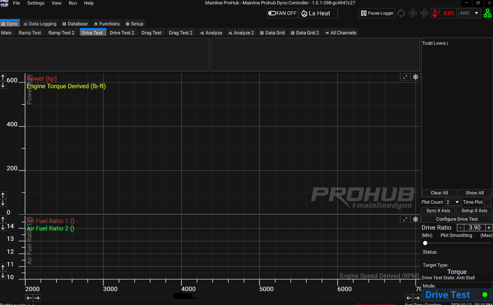
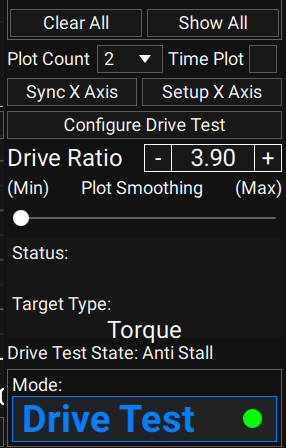
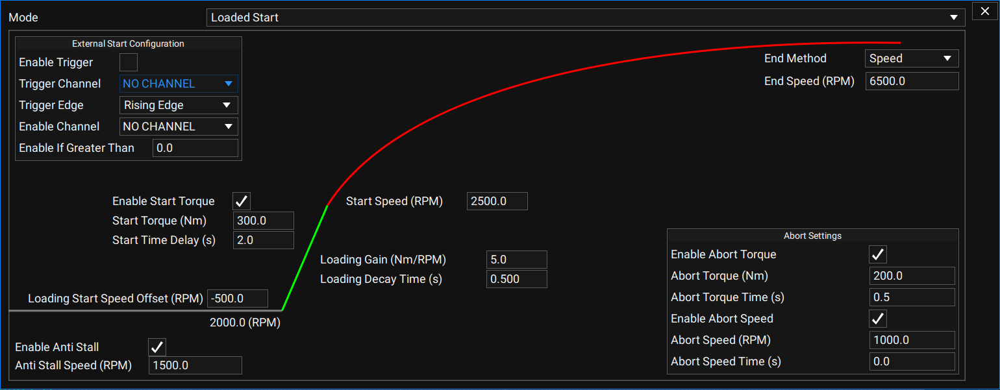

## Overview

The Drive Test is a "Ramp Test" style test, but instead of a pre-defined Test Time or Ramp Rate, it applies load based on the vehicle's **Test Weight** and **acceleration rate**, mimicking real road load. A heavier car with less power will take longer to complete the test than a lighter car with more power — just as it would on the road.

To access it, click the **Drive Test** tab at the top of any screen in the software:

A blank Drive Test screen looks like this:

## Screen Controls

The bottom right of the Drive Test screen has the following controls:

| Control | Description |
|---|---|
| **Clear All** | Clears all runs loaded in the test window buffer. The maximum number of runs shown is set under **Setup → Main → Miscellaneous** (1–10). Runs can be a mix of Ramp Tests and Drive Tests. |
| **Show All** | Un-hides any runs previously hidden via the eye icon next to a Test ID. |
| **Plot Count** | Number of plot windows shown (1–4). Each is configured via its gear icon for channels and scaling. |
| **Time Plot** | Shows a Time Plot at the bottom of the test window; channels are chosen via the gear icon. |
| **Sync X Axis** | Rescales the X axis to the values set in **Setup X Axis**. |
| **Configure Drive Test** | Opens the settings window covered below. |

Normal practice is to set the X-axis Start/End RPM about 500 rpm outside the Drive Test's Start/End Speed, so the entire test is visible on screen.

## Configure Drive Test

Four basic settings need to be set: **Start Speed (RPM)**, **End Speed (RPM)**, **Start Torque (Nm)**, and **Start Time Delay (s)**.

- The dyno applies load starting around 500 rpm below the Start Speed, and keeps applying load until the Start Speed is reached.
- Once Start Speed is reached, the **Start Time Delay** activates — typically 2–3 seconds — to allow the driver to progressively reach wide open throttle.
- **Enable Start Torque** sets the axle torque that must be attained before the Loading Start Speed activates.

Unlike a normal Ramp Test — where the operator taps the space bar to initiate, start, and end the test — Drive Test mode initiates automatically once the start conditions are met, then starts after the timer counts down.

Because load in a Drive Test depends on how much power the car makes (based on the vehicle Mass entered under **Database → Vehicle**), the car will "ramp" quite differently to a traditional Ramp Test. It can take a few runs to get a feel for how a Drive Test starts and performs — the operator needs to reach and hold a certain torque level for the timer to count down and the test to start.

The same loading algorithm is used in **Drive** mode on the Main page, so you can practice there at any time: drive up to, say, 4th gear, roll into wide open throttle, and you'll effectively be doing a Drive Test.

## Engine RPM and Torque Converter Slip

The CCS system operates in Engine RPM. Start and End Speed values are calculated from the **Drive Ratio** entered in the Vehicle Setup tab (or entered directly on the Ramp screen).

> **Important:** Start/End RPM values are only valid with a correct Drive Ratio **and** a manual transmission. If the vehicle has an automatic transmission without a lock-up torque converter, the Start/End Speed RPM will not match the actual Tacho RPM measured by the dyno or an external ECU logger, due to torque converter slip.

If a tach signal lead is connected, or a CAN RPM channel is set up and received by the CCS software, converter slip can be evaluated directly. There is at least one built-in Maths Function showing a converter slip calculation — the expression can be copied to build a converter slip channel for ECU RPM.
