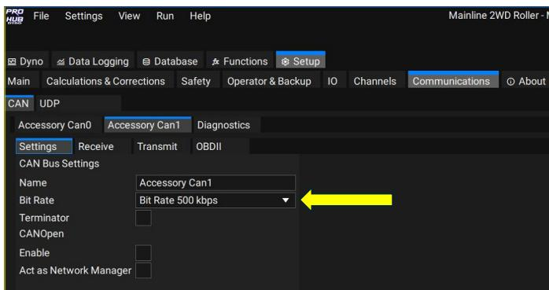
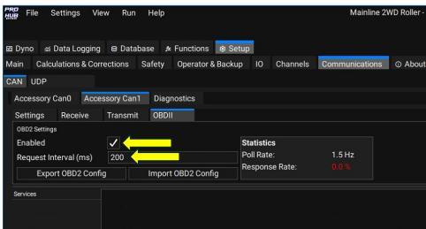
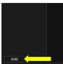
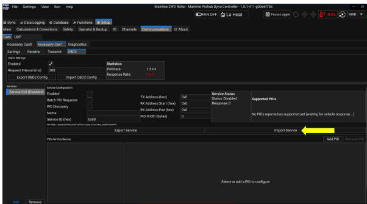
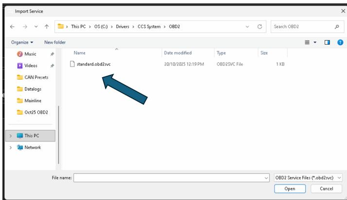
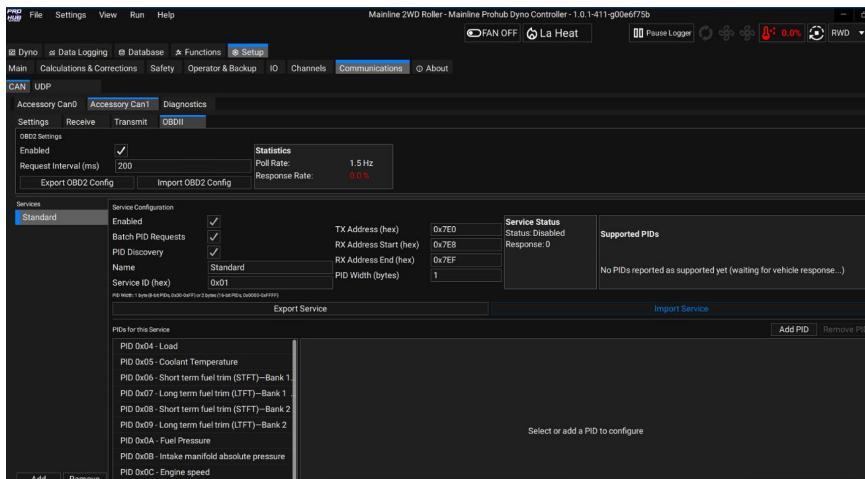
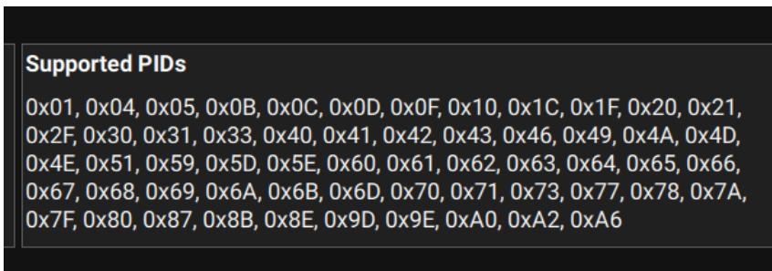
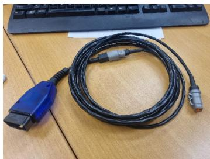
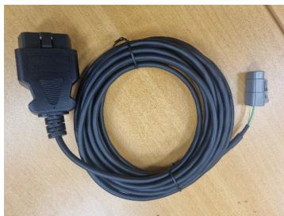

This document outlines the setup procedure for the OBD2 function in the Mainline CCS
Software.

A generic **“OBD2”** Can cable is supplied with your dyno. This cable is a “straight thru”
non electronic cable, meaning it is just a direct connection to the Vehicle CAN Bus via
the OBD2 socket, there is no “electronics” inside the cable such as what there would be
on an “Elm327” style of cable that would plug into a USB port or use Bluetooth. ONLY a
Mainline Supplied OBD2 cable can be used and is to be plugged into the CAN 4 A or 4B
sockets of the CAN hub.

The OBD2 Function in the Mainline CCS software is derived to be a somewhat “User
Definable” set of PIDs to access/log from the test vehicle. A generic set of PIDs may be
included with the installed software, and “installing “ is covered below.

Firstly, go to the `Communications` Tab – Click on `Accessory Can1` – `Settings`, and make
sure the `Bit Rate` is set to `500kps`.

After the `Bit Rate` has been set on `Accessory Can1`, click on the `Communications` Tab – `Accessory Can1` – `OBDII`.

On the `OBDII` tab, click the `Enable` check Box, set a default `Request Interval` to `200 ms`.

After Enabling and setting a `Request Interval`, click the ‘Add” button at the bottom left of
the screen:

The screen will now look like this:

Now click the Import Service Button.

You will then be prompted to select an “OBD2 Service” set from a folder on the PC,
generally you would find the file `standard.obd2svc` located in the `C:\Drivers\CCS
folder`, but it may be in the Documents folder, or you may be able to download it from the
Mainline Download Server (available March 2026), or it may be emailed to and you can
save it anywhere you wish on the Dyno PC. The example shown below the file was
located in `C:\Drivers\CCS System\OBD2` for example:

Once the “Service” has been loaded, the screen will change and show the PIDs that are
setup withing the “Service File”:

The Standard OBD2 service ?le only has the first 20 generic OBDII PIDs,

Essentially once all these steps have been completed, the Dyno Software should be
polling the test vehicle CAN bus for OBDII data. The PIDs shown in the Standard Service
may not be all available on the test vehicle. Once connected and polling for PIDs/Data
the Supported PIDs box will show the PIDs supported by the test vehicle:

The above example is from a 2023 Ford Ranger, and many of these PIDs are well beyond
the Standard Service PIDs. A user can generate their own custom OBDII “Services” for
specific vehicles, and these “Services” can be Added or Removed when needed.

For best results, due to the way OBDII operates from a polling and data receive point of
view, the lowest amount of PIDs “polled” will return the highest Poll rate.

Users of CCS system could if wanted, share OBDII services, as the ability certainly
exists for advanced users to write OBDII Services to acquire Manufacturer Specific PIDs
on Mode 21 or Mode 22 for example. The Standard Service just deals with Mode 1.

Further information on the Topic of OBDII can be found here
https://en.wikipedia.org/wiki/OBD-II_PIDs

There have been 2 sorts of OBD2 cables supplied, the blue version was an earlier
version where the end was removable so the cable could be used as “Generic” CAN
cable, or the later OBD2 only end version:

