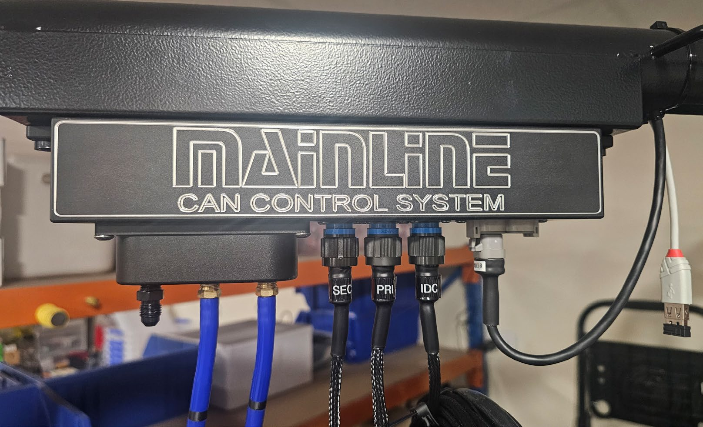
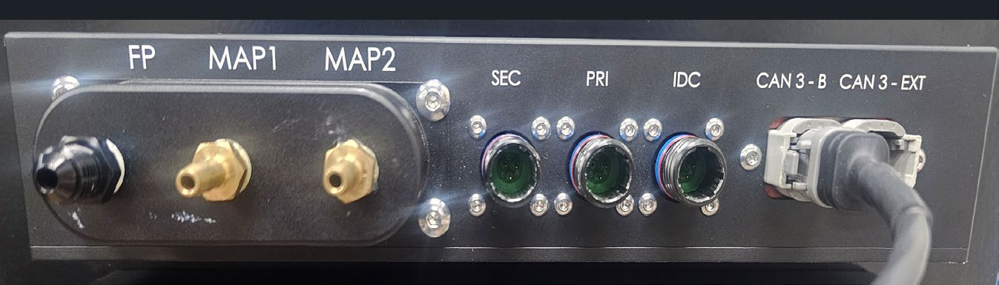
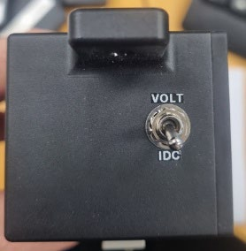
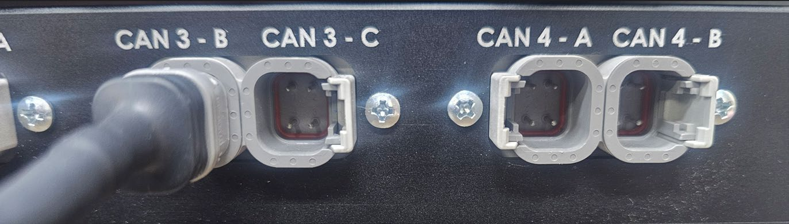

The Cabinet is packed with many internal connections already in place. The boom arm, boom arm DAQ module, monitor bracket and
monitors need to be fitted during assembly of the dynamometer.

## CCS Dynamometer Modules to Cabinet Connections

The modules are marked `REAR LEFT` and `REAR RIGHT` (2WD Models) in reference to the vehicle position when
mounted to the dynamometer.

A unit with the AWD Ready option will also have `FRONT LEFT` and `FRONT RIGHT` connections on the opposite
side of the cabinet, as well a Vehicle Cooling Fan power socket.

The larger harnesses coming from the dynamometer modules are plugged in to the side of the cabinet that
will be marked `REAR LEFT` and `REAR RIGHT` accordingly.

***

*ProHub 2WD Models*
***

*Orange Plug Rear Left Example*
***

*AWD Ready & Fan Sockets*
***

The purple CAN harnesses can be threaded through the bottom of the cabinet and secured with the conduit
retaining brackets located as shown in the image to the left.

***

**TIP:** For US models there is a 110V power cable inside the cabinet that can be passed down and out
through the aperture at the bottom of the cabinet before fitting the purple CAN harnesses.

## CAN Harness Connections (Purple Cables)

The purple CAN cables from bottom of the cabinet and connected to the CAN hub mounted on the inside
shelf of the cabinet - Marked 1 & 2

Ensure you push the connections in and **rotate the outer locking rings** clockwise to fully pull in
and make a complete connection.

**NOTE:** An AWD Ready Cabinet will have a CAN hub with
4 connectors as shown on the above image.

The additional (3 & 4) are for future use when
upgrade to an AWD model.

## Boom Arm DAQ Module Connections

(2026 Models Onwards)

After the boom arm is fitted to the cabinet, the boom arm DAQ module needs to be fitted with the supplied
screws.

Make the following connections to the boom arm DAQ module:

**SEC** Secondary Ignition RPM / Tacho (inductive clamp).
**PRI** Primary Ignition RPM / Tacho (voltage spike probe).
**IDC** Injector Duty Cycle / Analog Voltage Input Cable (voltage spike probe).
**CAN 3-B** CAN cable connection. This CAN cable will be inside the boom arm when packed.
**MAP 1** Connect 5 metre Vacuum / Pressure Hose.
**MAP 2** Connect 5 metre Vacuum / Pressure Hose.
**FP** Fuel Pressure. User can connect their own pressure hose for fuel pressure measurements.

The Weather Station is located internally in the boom arm DAQ module.

**IDC/Voltage toggle switch** toggles the input from the IDC lead between IDC function and 0-30V DC function.

The CAN cable fitted to **CAN 3-B** on the boom arm DAQ module is connected through the boom arm to the
CAN hub inside the cabinet at position **CAN 3-B**, as shown below.

**CAUTION:** Do not fit the OBD2 cable into the **CAN3-EXT** port on the DAQ box - OBD2 runs at 500 kb
bus speed and will crash the 1 Mb bus the Data Acquisition box communicates at.

## US Models Only - 110V Power Plug

This 110V power plug is to be plugged in to a general power outlet.

## AFR Meter - Mainline LC-2

The Twin Channel AFR meter is mounted on the inside right had side of the cabinet. It will already be connected,
apart from the 1 or 2 AFR Sensor harnesses. These harnesses are connected to the AFR meter DTM connectors
and passed out through the aperture at the bottom of the cabinet and connected to the 02 Sensor/s supplied.

**NOTE:** The 'Analog Out" harness coming from the AFR meter is not used for CCS models.

## Optional Vehicle Fan Power Outlet

The vehicle fan power outlet is on the upper left or the upper right-hand side of the cabinet, depending on if the
dynamometer is for Left- or Right-hand drive vehicles. The outlet is wired for the specified mains power, for
example 380V - 415V 3PH (Australia - Europe), 208V 3PH (Japan - USA), or 220V 1PH (Japan - USA).

Fan switching can be controlled manually ON or OFF via the CCS software, either by clicking the **FAN** icon
on screen or by pressing the **V** key on the keyboard.

## Optional Thermocouple Module

The optional 8 Channel Thermocouple module CAN-EGT8 is mounted on the boom arm with the supplied
adapter bracket and has a CAN harness marked `MLCCS-EGTBOXCBL` that plugs into the DTM4 socket
marked **CAN 3-EXT** on the Data Acquisition box.

## Mains Power Supply (To the cabinet)

The larger harness shown below (with orange plug) is to be connected to your mains power supply wall socket.
The ProHub units will be wired to suit destination country power supply. If you are not sure, please contact
Mainline for clarification of your specific power requirements.

